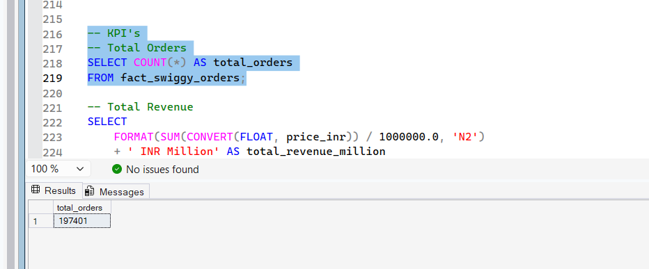
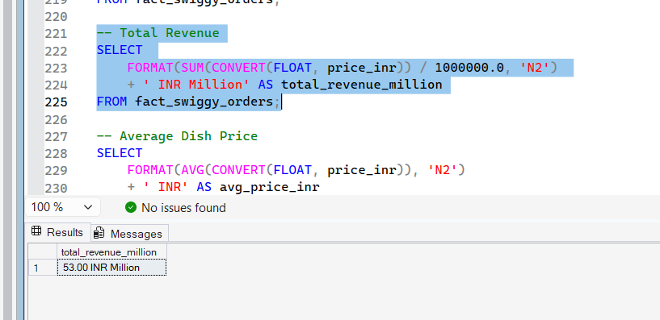
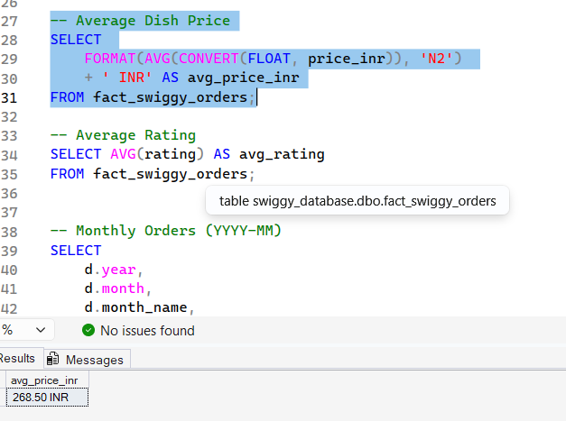
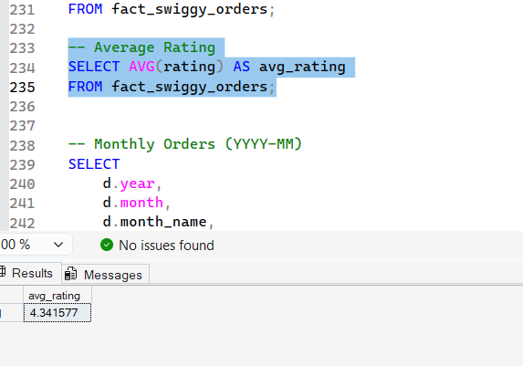
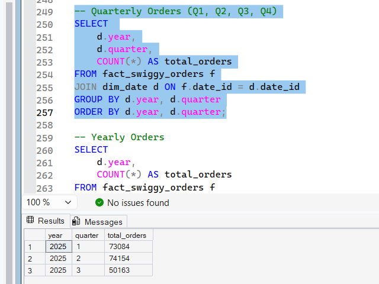
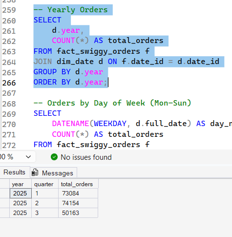
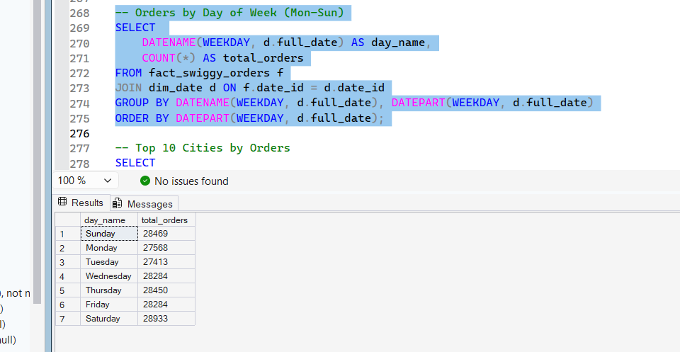

# Swiggy Data Analysis Using SQL

## 1. Project Overview

The **Swiggy Data Analysis Project** is an SQL-based data analytics project developed using Microsoft SQL Server.

The main objective of this project is to analyze Swiggy food order data and understand order trends, restaurant performance, popular food categories, dish prices, customer ratings, and revenue across different locations.

This project includes data cleaning, database design, table creation, data loading, KPI calculation, and business analysis using SQL queries.

## 2. Database Information

| Detail | Description |
|---|---|
| Project Name | Swiggy Data Analysis |
| Database | swiggy_database |
| SQL Language | Microsoft SQL Server |
| Dataset Format | CSV |
| Database Design | Star Schema |
| Main Table | fact_swiggy_orders |

## 3. Tables Used

The project uses one source table and five dimension tables with one fact table.

### Source Table

| Table Name | Purpose |
|---|---|
| Swiggy_Data | Stores the original Swiggy dataset used for cleaning and analysis |

### Dimension Tables

| Table Name | Purpose |
|---|---|
| dim_date | Stores date-related information such as year, month, quarter, and day |
| dim_location | Stores state, city, and location information |
| dim_restaurant | Stores restaurant names |
| dim_category | Stores food categories |
| dim_dish | Stores dish names |

### Fact Table

| Table Name | Purpose |
|---|---|
| fact_swiggy_orders | Stores order-related measures such as price, rating, and rating count, along with dimension keys |

## 4. Database Design – Star Schema

A Star Schema was designed to organize the data into fact and dimension tables.

- **Fact Table:** `fact_swiggy_orders`
- **Dimension Tables:** `dim_date`, `dim_location`, `dim_restaurant`, `dim_category`, `dim_dish`

The fact table connects to the dimension tables through foreign keys. This structure helps perform analysis using SQL JOIN operations.


## 5. Project Workflow

1. Imported the Swiggy dataset into SQL Server.
2. Explored the source data using SELECT queries.
3. Checked missing values and blank values.
4. Identified duplicate records.
5. Removed duplicate records using a CTE and ROW_NUMBER().
6. Created dimension tables and a fact table.
7. Loaded data into the dimension and fact tables.
8. Calculated key performance indicators (KPIs).
9. Performed business analysis using SQL queries.
10. Captured query outputs for reporting.

## 6. SQL Concepts Used

| SQL Concept | How It Was Used |
|---|---|
| SELECT | Retrieve data from tables |
| WHERE | Filter records |
| GROUP BY | Group data for analysis |
| ORDER BY | Sort query results |
| COUNT() | Count records |
| SUM() | Calculate total revenue |
| AVG() | Calculate average price and rating |
| CASE | Categorize dish prices |
| JOIN | Combine fact and dimension tables |
| CTE | Identify duplicate records |
| ROW_NUMBER() | Assign row numbers to duplicate records |
| Primary Key | Uniquely identify records in dimension and fact tables |
| Foreign Key | Connect fact and dimension tables |
| Date Functions | Analyze dates, months, quarters, and years |
| FORMAT() | Format numerical results |
| OFFSET and FETCH | Retrieve the top 10 results |

## 7. Key Performance Indicators (KPIs)

The following KPIs were calculated using SQL:

1. Total Orders
2. Total Revenue
3. Average Dish Price
4. Average Rating

### KPI Output Screenshots

**Total Orders**



**Total Revenue**



**Average Dish Price**



**Average Rating**



## 8. Business Questions

The following business questions were selected to understand the Swiggy dataset:

1. Total Orders 
2. total revenue 
3. average dish price
4. average rating 
5. Monthly orders
6. quarterly orders
7. yearly orders
8. Orders by day of week(Mon-Sun)
9. Top 10 cities by orders
10.Top 10 Restaurants by Orders
11. Top Categories by Order Volume
12 .Most Ordered Dishes
13. Total Revenue by State
14. Total Orders by Price Range
15. Rating Count Distribution(1-5)
16.Orders + Avg Rating

## 9. Business Queries and SQL Solutions

The following queries answer the business questions using SQL.

### Q1. How many orders are placed each month?

**Business Objective:** Identify monthly order trends.

```sql
SELECT
    d.year,
    d.month,
    d.month_name,
    COUNT(*) AS total_orders
FROM fact_swiggy_orders f
JOIN dim_date d
    ON f.date_id = d.date_id
GROUP BY d.year, d.month, d.month_name
ORDER BY d.year, d.month;
```

**Output:**

.png)

### Q2. How do orders change across quarters and years?

**Business Objective:** Understand quarterly and yearly order trends.

**Quarterly Orders:**

```sql
SELECT
    d.year,
    d.quarter,
    COUNT(*) AS total_orders
FROM fact_swiggy_orders f
JOIN dim_date d
    ON f.date_id = d.date_id
GROUP BY d.year, d.quarter
ORDER BY d.year, d.quarter;
```


**Yearly Orders:**

```sql
SELECT
    d.year,
    COUNT(*) AS total_orders
FROM fact_swiggy_orders f
JOIN dim_date d
    ON f.date_id = d.date_id
GROUP BY d.year
ORDER BY d.year;
```

**Output:**



### Q3. Which days of the week have the highest order volume?

**Business Objective:** Identify the days with higher order activity.

```sql
SELECT
    d.day,
    COUNT(*) AS total_orders
FROM fact_swiggy_orders f
JOIN dim_date d
    ON f.date_id = d.date_id
GROUP BY d.day
ORDER BY total_orders DESC;
```

**Output:**



### Q4. Which are the top 10 cities by order volume?

**Business Objective:** Identify cities with the highest number of orders.

```sql
SELECT
    l.city,
    COUNT(*) AS total_orders
FROM fact_swiggy_orders f
JOIN dim_location l
    ON f.location_id = l.location_id
GROUP BY l.city
ORDER BY total_orders DESC
OFFSET 0 ROWS FETCH NEXT 10 ROWS ONLY;
```

**Output:**


### Q5. Which restaurants receive the highest number of orders?

**Business Objective:** Identify the top 10 restaurants based on order volume.

```sql
SELECT
    r.restaurant_name,
    COUNT(*) AS total_orders
FROM fact_swiggy_orders f
JOIN dim_restaurant r
    ON f.restaurant_id = r.restaurant_id
GROUP BY r.restaurant_name
ORDER BY total_orders DESC
OFFSET 0 ROWS FETCH NEXT 10 ROWS ONLY;
```

**Output:**


### Q6. Which food categories and dishes are most popular?

**Business Objective:** Identify popular food categories and frequently ordered dishes.

**Category Analysis:**

```sql
SELECT
    c.category,
    COUNT(*) AS total_orders
FROM fact_swiggy_orders f
JOIN dim_category c
    ON f.category_id = c.category_id
GROUP BY c.category
ORDER BY total_orders DESC;
```

**Dish Analysis:**

```sql
SELECT
    d.dish_name,
    COUNT(*) AS order_count
FROM fact_swiggy_orders f
JOIN dim_dish d
    ON f.dish_id = d.dish_id
GROUP BY d.dish_name
ORDER BY order_count DESC;
```

**Output:**


### Q7. Which states generate the highest revenue?

**Business Objective:** Compare revenue across different states.

```sql
SELECT
    l.state,
    SUM(CONVERT(FLOAT, f.price_inr)) AS total_revenue
FROM fact_swiggy_orders f
JOIN dim_location l
    ON f.location_id = l.location_id
GROUP BY l.state
ORDER BY total_revenue DESC;
```

**Output:**


### Q8. How are orders distributed across different price ranges?

**Business Objective:** Understand order distribution based on dish prices.

```sql
SELECT
    CASE
        WHEN price_inr < 100 THEN 'Under 100'
        WHEN price_inr BETWEEN 100 AND 199 THEN '100 - 199'
        WHEN price_inr BETWEEN 200 AND 299 THEN '200 - 299'
        WHEN price_inr BETWEEN 300 AND 499 THEN '300 - 499'
        ELSE '500+'
    END AS price_range,
    COUNT(*) AS total_orders
FROM fact_swiggy_orders
GROUP BY
    CASE
        WHEN price_inr < 100 THEN 'Under 100'
        WHEN price_inr BETWEEN 100 AND 199 THEN '100 - 199'
        WHEN price_inr BETWEEN 200 AND 299 THEN '200 - 299'
        WHEN price_inr BETWEEN 300 AND 499 THEN '300 - 499'
        ELSE '500+'
    END
ORDER BY total_orders DESC;
```

**Output:**


### Q9. How are ratings distributed?

**Business Objective:** Understand the distribution of ratings in the dataset.

```sql
SELECT
    rating,
    COUNT(*) AS rating_count
FROM fact_swiggy_orders
GROUP BY rating
ORDER BY rating;
```

**Output:**


### Q10. Which food categories perform best based on order volume and average rating?

**Business Objective:** Compare food category popularity and average ratings.

```sql
SELECT
    c.category,
    COUNT(*) AS total_orders,
    AVG(CONVERT(FLOAT, f.rating)) AS avg_rating
FROM fact_swiggy_orders f
JOIN dim_category c
    ON f.category_id = c.category_id
GROUP BY c.category
ORDER BY total_orders DESC;
```

**Output:**


## 10. Project Outcomes

- Practiced SQL data cleaning and duplicate identification.
- Designed a relational database using a Star Schema.
- Created and populated fact and dimension tables.
- Used joins to combine data from multiple tables.
- Calculated business KPIs.
- Analyzed order trends, restaurant performance, popular dishes, ratings, and revenue.
- Practiced CTEs and window functions for duplicate removal.

## 11. Conclusion

This project helped me gain practical experience in SQL Server, data cleaning, database design, and business data analysis. It demonstrates how SQL can be used to transform raw data into meaningful business insights.

## 12. Tools and Technologies

- Microsoft SQL Server
- SQL Server Management Studio (SSMS)
- Microsoft Excel
- GitHub

